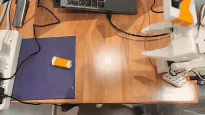
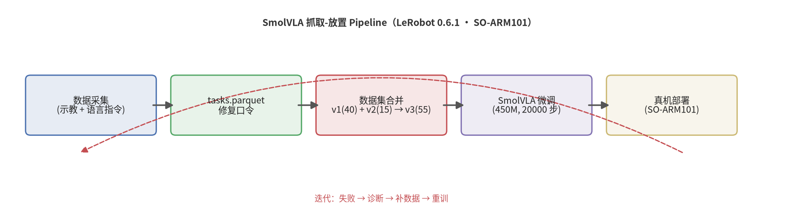

# so101-smolvla-grasping

基于 SmolVLA（Vision-Language-Action Model）的机械臂抓取-放置系统，运行在 SO-ARM101 六自由度机械臂上，使用 LeRobot 框架完成从数据采集到真机部署的 **VLA 微调闭环**。

## 🎥 演示效果



> 演示：SO-ARM101 从臂抓取纸巾卷（橙黄色胶带缠绕的圆柱状）并放置到蓝紫色目标区域（手机实拍）

完整演示视频（三轮抓取）见 [GitHub Releases v1.0](https://github.com/oye-Li-bc/so101-smolvla-grasping/releases/tag/v1.0)：
- 手机实拍（上帝视角）
- 部署录屏（Rerun 可视化 + 终端日志）

## 📊 成果概览

- **任务**：SO-ARM101 从臂抓取纸巾卷（橙黄色胶带缠绕的圆柱状纸巾卷）并放置到蓝紫色目标区域
- **数据**：55 条示教轨迹（v1 40 条 + 补录 v2 15 条），15,625 帧（25 FPS，1080p）
- **模型**：SmolVLA（450M 参数；冻结 VLM 骨干，仅训练动作专家约 100M 可训练参数），20,000 步微调
- **性能**：真机成功抓取-放置 ✅；**夹取动作质量优于 ACT 基线**；泛化受限于数据多样性与单目视角

## 🏗️ 技术方案

```
数据采集(示教+语言指令) → 数据集合并(v1+v2→v3) → VLA 微调 → 真机部署 → 迭代优化
```



## 📁 目录结构

```
so101-smolvla-grasping/
├── docs/          # 技术文档（概述/数据采集/训练/部署/实验记录）
├── scripts/       # 录制、合并、修复、训练、部署脚本
├── results/       # 训练曲线、演示视频（视频放 B站，此处放说明）
├── data/          # 数据集说明（权重和数据集托管在 HuggingFace）
└── assets/        # README 配图
```

## 🚀 快速复现

### 1. 录制数据（含语言指令）

```bash
bash scripts/record.sh
```

> 录制时按提示输入任务口令（一字不差，训练/部署共用）：
> `Pick up the tissue roll wrapped with orange-yellow tape on the wooden table and place it on the blue-purple area`

### 2. 合并数据集 + 微调

```bash
python scripts/fix_tasks_parquet.py   # 补语言指令（tasks.parquet）
python scripts/merge_datasets.py      # v1(40集)+v2(15集) → v3(55集)
bash scripts/train.sh                 # SmolVLA 微调（20000 步）
```

### 3. 部署

```bash
bash scripts/deploy.sh
```

## 🔧 关键工程细节

- **语言指令是 VLA 的命脉**：`tasks.parquet` 必须含任务描述（LeRobot 录制默认不写！），且训练/部署的 `--task` 口令必须一字不差
- **单相机适配**：数据集 `front` → 模型 `camera1`（`--rename_map`），另用 `--policy.empty_cameras=2` 补空相机位（官方 aloha 单相机先例同款做法）
- **分辨率对齐**：部署相机必须与训练数据同分辨率（1920×1080），否则模型误判距离（ACT 同款教训）
- **fourcc MJPG**：1080p 下必须用 MJPG，否则回退 YUYV 仅 5 FPS
- **显存友好**：SmolVLA 默认冻结视觉编码器 + 只训动作专家，11.5GB 显卡可跑 batch=8，实测 ~3.8 step/s
- **命令行的坑**：`--参数=~/路径` 中 `~` 不展开（用绝对路径）；`--policy.path` 与 `--policy.type` 不能同时给（0.6.1 校验）

## 📚 文档索引

- [docs/01-项目概述.md](docs/01-项目概述.md)
- [docs/02-数据采集.md](docs/02-数据采集.md)
- [docs/03-模型训练.md](docs/03-模型训练.md)
- [docs/04-部署与迭代.md](docs/04-部署与迭代.md)
- [docs/05-实验记录.md](docs/05-实验记录.md)

## 📦 模型与数据集

- 数据集：v3 合并数据集（55 集）——本地 `~/.cache/huggingface/lerobot/oye-Li-bc/oye_tissue_v3_20260825_161500`，待上传 HuggingFace
- 模型权重：`smolvla_v2` checkpoint（20,000 步）——本地 `~/output_lerobot_train/tissue/smolvla_v2`，待上传 HuggingFace

## 🧰 环境

- LeRobot 0.6.1 · PyTorch 2.11 · CUDA 13.0
- RTX 5070 Ti 11.5GB（140W）
- SO-ARM101（主臂示教 + 从臂执行）

## 📄 License

MIT
